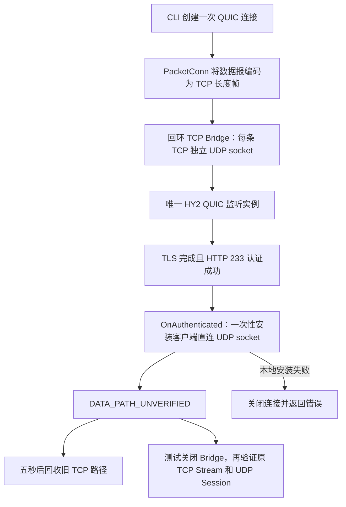

# Worker HDM：M0 审计与 M1 本地验证设计

## 范围与基线

基线：`fc46203`，原有同 IP 双端口 HDM 保留。依赖为
`github.com/apernet/quic-go v0.63.1-0.20261004180939-a10df75c260c`。
本阶段只开发官方 CLI、本地 TCP-to-UDP Bridge 和跨源 IP 的集成测试。
不部署 Cloudflare、Tunnel 或 VPS，不移植 Throne，不开通付费服务。

未来 Cloudflare 接入按 Free 套餐设计。域名可以用 workers.dev，
`hdm.example.com` 只是候选。VPC Beta 免费不构成长期价格承诺。
M1 的 TCP 帧协议是中继外层封装，不改变内部 HY2/QUIC wire format。

## 源码结论

- `app/cmd/client.go`：配置解析 → 单次 ConnFactory → transport → obfs。
- `core/client/client.go`：同一 PacketConn 创建 QUIC Transport，HTTP/3 POST
  认证收到 233 后同步调用 `OnAuthenticated`，之后才返回 `NewClient`。
  不需要添加另一套 TLS 或认证代码。
- `extras/transport/udphop/conn.go`：逻辑远端地址保持稳定，切换实际 socket，
  新旧 socket 共用接收队列。`migration.go` 用 sync.Once 保证成功或失败均只尝试一次，
  旧 socket 五秒后回收。直接复用这些资源，不建立第二套切换接收器。
- 客户端和服务端设置 `DisablePathManager: true`。所固定的 quic-go fork
  在服务端成功处理短包头包后，发现地址变化就更新回包地址，没有同 IP 限制。
  Connection ID 将新源地址的数据关联到原连接。客户端所见逻辑服务端地址仍不变。
- 这不等于标准 QUIC 路径验证。该分支跳过服务端 path manager；服务端的
  PATH_CHALLENGE 响应也依赖该 manager，不能直接调用 AddPath/Probe 就声称已验证。
- 当前 UDP wrapper 暴露 SyscallConn；初始 TCP transport 不能假装有 UDP syscall。
  新适配器仅向 QUIC 暴露 PacketConn，使用通用收发路径。
- obfs 位于路径切换器外层：QUIC → obfs → 切换器 → TCP 帧或 UDP。
  Bridge 只转发不透明数据报，不持有 HY2 密码、TLS 私钥或终止端到端 TLS。
- Authenticator 看到的初始 RemoteAddr 为 Bridge 的 UDP 地址，基于源 IP 的
  认证、审计和限流语义会变化。源 IP 迁移必须通过真实 socket 测试确认。

## 本地调用链

UDP WriteTo 成功只代表本地发送；收到数据报不代表它通过 QUIC 解密；
原业务流的完整应答在中继关闭后成功，才是本测试的端到端可用性证据。
生产 M1 不导出 ACTIVE 状态，不提供路径确认超时或自动回退；数据黑洞交由
现有 QUIC 超时关闭。可靠的迁移确认和回退仍为独立后续任务。

## 预计修改文件

| 位置 | 用途 |
| --- | --- |
| extras/transport/packetframe | 两字节大端长度帧，保持数据报边界，限制 1..2048 字节 |
| extras/bridge/tcpudp | 固定回环 UDP 目标、独立会话、并发/字节/时限约束、关闭回收 |
| extras/cmd/hdm-bridge | 本地 Bridge 可执行程序 |
| extras/transport/udphop | 复用切换器，接纳外部初始 PacketConn，隔离旧路径 EOF |
| extras/transport/workerhdm | TCP PacketConn、拨号及握手硬时限 |
| app/cmd/client_worker_hdm.go、client.go | 实验性 tcpBridge 配置和现有认证回调接线 |
| 对应测试、配置样本、docs/worker-hdm-local.md | 自动化测试、运行步骤与结果边界 |

## 资源和失败约束

- 本地 M1 仅接受字面量回环 TCP 地址，Bridge UDP 目标同样固定为回环地址。
  无任意目标字段、无公网监听。这里的信任边界是本机进程；公网 Worker 的独立
  token、Tunnel 策略与访问控制待 M2 实现，不能把本地桥直接暴露到公网。
- 帧最大 2048 字节；零长度和超长帧立即拒绝，不按攻击者长度分配内存。
- Bridge 默认并发 64、单会话双向合计 1 MiB、硬生命周期 15 秒、空闲超时 5 秒。
  两个转发循环直接读写并施加背压，不建立无界队列。EOF、超额或超时关闭两端。
- 客户端 TCP 连接及握手有独立超时；新建连接重新经过 Bridge。初始 TCP 失效
  必须使握手及时失败；切换后旧 TCP 的 EOF/超时不能关闭新 UDP 路径。
- 不重试迁移，不提供 WS 业务兜底。socket 创建失败沿用 core 的清理路径。

## 验证计划和未验证假设

先验证帧边界、超额、超时、关闭和并发；再验证真实 QUIC/HY2 TCP/UDP，
让 Bridge 与直连 socket 使用不同回环 IP，检查认证/TLS 次数、直连 Initial、
100 次重连、切换时现存会话、短暂丢包和关闭竞态，并回归旧 HDM。
Windows 使用 Go 1.26.3（旧记录中 1.26.0 race runtime 有问题）。

本地两个回环 IP 不能代表公网 NAT、MTU、跨网络 RTT 或封锁行为。
本阶段没有 Cloudflare WSS/VPC 实测，不提供公网成功率、吞吐对照或抗检测结论。
TCP 承载 QUIC 有队头阻塞和重传叠加，仅作为短期握手通路。
旧路径迟到包可能使禁用 path manager 的服务端暂时重新选择旧地址；关闭旧路径
后能否恢复，以及对丢包的影响，需要实测而不是由源码推定。

M0 基线验证：Go 1.26.3 下 `go test ./extras/transport/udphop ./core/client
-count=1 -timeout=90s` 通过。M1 结果另记，不能把计划当成测试通过。
