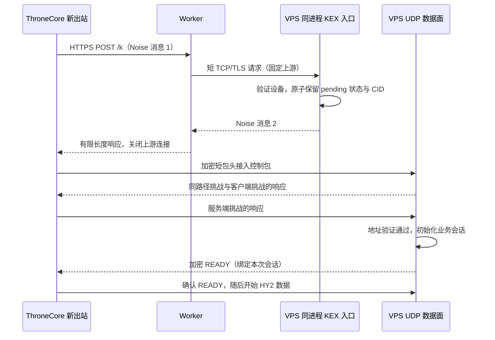

# Worker KEX：设备认证与带外握手设计

> 提交标识说明：本页项目提交 SHA 已映射为身份改写后的等价文件树提交；原构建时的 SHA 记录仅保留在本机。

日期：2026-10-28。状态：设计草案 v0.1；尚未实现，不是可直接发布的密码协议规格。
代码基线：`cf63552`（0.5.6），分支 `codex/worker-hdm-local`。

后续实现记录见 `worker-kex-implementation.md`；真实 UDP、HY2 与 Worker 的实验进度及验证边界见 `worker-kex-network-acceptance.md`。Throne 原生出站尚未集成。
本文保留设计阶段的范围与验收要求；以下“本轮”指设计文档提交时的范围。

本文承接用户已经确认的需求，规定后续实现的边界、状态和验收方法。
涉及密钥导出、控制流编码和 quic-go 内部状态的部分仍需技术验证；不能用本文宣称新协议已经安全或可用。
本轮仅新增设计文档，不修改程序、构建产物、客户端配置、服务器或 Cloudflare 资源。

## 1. 已确认的产品决策

- 将新客户端作为 Go 库集成进 ThroneCore，保留 GUI 与核心的既有进程结构，不再启动 `hysteria-worker.exe`，不经本机 SOCKS 转接。
- 云函数仅参与建连。正常传输不经过 Worker，不保留专用握手连接、WSS、独立 Bridge 或 cloudflared Tunnel。
- 客户端向 VPS 发出的第一个 UDP 包就是加密短包头；允许后续短包头确认和地址验证，不发送直连 Initial、Handshake 或 0-RTT 包。
- 使用独立设备密钥和新的配置格式。新模式不携带原 HY2 密码，也不假装兼容旧 `hysteria2://` 分享链接。
- 建连失败直接拒绝本次连接，明确返回错误。不自动换协议、换节点、走 WSS、普通 HY2 或 mieru。
- 本次尝试不会自动重新发起 KEX。丢包后的同会话 UDP 重传仍允许，且受总时限约束；这不是协议降级。
- 会话失效后关闭对应业务流，不后台循环重建；用户显式重新连接才开始新尝试。
- 仅以 Cloudflare 免费方案为部署约束，不自动开通收费功能；超出可用配额时返回错误。
- 不承诺网络切换时保住现有连接，不宣称绝对抗识别，也不宣称该组合没有先例。

## 2. 当前实现与新方案的区别

现有实现见 `worker-hdm-design.md`、`throne-worker-hdm.md` 和 `worker-hdm-audit-20261028.md`。
当前链路为 WSS → Worker → Tunnel → Bridge → HY2，收到 HTTP 233 后迁移同一个 QUIC 会话。
ExtraCore 仍承担后续数据面，因此关闭 WSS 本身不能消除客户端额外进程。

新方案保留 HY2 业务层及尽可能多的 QUIC 数据面逻辑，但替换端到端安全握手。
它是需要两端配套的新模式，不是普通 TLS QUIC 的透明兼容扩展。[R2]

本地源码确认：

| 位置 | 对设计的影响 |
| --- | --- |
| `core/client/client.go` | 当前认证响应还决定 `Rx`、`RxAuto`、`UDPEnabled`，不能只伪造 233 |
| `core/server/server.go` | `h3sHandler` 持有认证、UDP 与在线状态，新入口需要统一初始化与清理 |
| `core/client/client.go` | Chrome 模式设置零长度 CID，新模式必须有独立的非零 CID 策略 |
| `core/client/client.go`、`core/server/server.go` | 当前关闭路径管理，不能借此宣称新地址已经验证 |
| `../Throne-hdm/core/go.mod` | 已间接引用 apernet/quic-go `0.61.1…` |
| `core/go.mod` | 引用 apernet/quic-go `0.63.1…`，集成前需检查同模块版本统一的影响 |
| `../sing-quic-hdm/go.mod` | 使用 sagernet/quic-go，不能假定两个 fork 的连接对象兼容 |
| `../sing-box-hdm/include/registry.go` | 存在原生出站注册入口，可实现库适配 |

用户已完成原生 CMD/TUN 的浏览器测速；不能写成所有 TUN 都未验证。
现有 Throne ExtraCore 包的 TCP/UDP 有成功记录，但长期使用、网络变化与睡眠恢复未完成验收。
此前间歇性 UDP DNS 超时仍没有确定归因；旧版本成功不构成新方案的验证结果。

## 3. 架构与生命周期

图中确认报文是逻辑步骤，最终打包、控制流编码和重传规则在 B2 冻结；不承诺固定的物理包数。
Worker 不参与最后的 UDP 确认，VPS 的 KEX 监听与 UDP 数据面属于同一进程。
首次实验使用独立 UDP 监听与独立 CID 命名空间；是否合并现有监听，留待数据面验证后决定。
不抢占当前实验服务端口，具体端口属于部署阶段配置。

“只有一次 HTTPS 请求”指一次应用层请求/响应，不代表 TCP、TLS、DNS 和 UDP 验证只消耗一次 RTT。
客户端使用专用、可关闭的握手 HTTP transport；读完或失败后关闭响应体和空闲连接。
Worker 在 finally 路径关闭自己的上游 socket，不后台持有它。
客户端只能控制自己持有的连接，不能保证 Cloudflare 边缘内部的通用连接池全部销毁。
活跃 QUIC 数据连接与必要的 UDP 保活属于业务连接，不计为多余中继连接。

## 4. 身份、信任与配置

### 4.1 设备注册与撤销

客户端本地生成独立 X25519 静态密钥对；服务器登记公钥、设备标识、用户映射、权限和启用状态。
服务器另有静态密钥对，客户端通过可信配置预置服务器公钥与稳定的 service_id。
服务器公钥不通过未验证的 Worker 响应自动更新。

设备私钥不上传服务器、不包含在普通分享链接中、不记日志。首版配置使用私钥文件引用，限制文件访问权限；
Windows 凭据保护的具体实现属于客户端阶段，不在本文声称已经具备。
将节点配置分享给另一设备不会授予接入资格，新设备必须独立登记。
服务器密钥轮换使用显式导入的新配置，不接受握手失败后自动信任新公钥。

撤销设备后拒绝新 KEX，并清除其 pending 状态；活动会话由服务端主动关闭。
设备状态和权限在 pending 转 active 前再次检查，避免撤销与接入的竞态。

### 4.2 三种凭据分离

| 凭据 | 持有者 | 用途 |
| --- | --- | --- |
| 设备静态私钥 | 对应客户端 | 端到端身份认证 |
| Worker 接入令牌 | 客户端、Worker | 云端入口的粗粒度访问控制，可独立轮换 |
| Worker 上游凭据 | Worker secret、VPS | 限制谁可使用 KEX TCP 入口，不下发客户端 |

Worker 令牌泄露不能代替设备认证；Worker 上游凭据也不能代替客户端身份。
Cloudflare 管理 API 密钥、SSH 密钥均不属于运行配置。

### 4.3 新配置的逻辑字段

字段包括协议模式与版本、service_id、Worker HTTPS URL、Worker 令牌引用、服务器静态公钥、
设备私钥引用、VPS UDP 地址、握手总时限和客户端带宽偏好。
URL 不能携带凭据；不跟随 HTTP 重定向，不允许跳过 TLS 验证。
直连地址由可信配置指定，并由服务端在握手响应中确认；不接受 Worker 任意改写目的地址。

首版只提供配置文件导入。最终字段名与分享编码尚未冻结，本文不提供可误用的真实凭据样本。

## 5. 密码握手边界

### 5.1 候选模式

采用完整的 Noise IK 作为候选，不实现“仿 IK”。首版候选套件为
`Noise_IK_25519_ChaChaPoly_SHA256`，固定一个套件，拒绝未知版本与套件，不尝试自动降级。
客户端预知服务器静态公钥，服务器从握手中获得客户端静态公钥并检查设备登记。[R1]

Noise 第一条握手消息仍可被重放；第一消息中的设备身份和元数据也不应被描述为具有完整前向安全。
改用设备密钥避免在第一消息里发送长期可复用密码，但不意味着长期密钥泄露不再有影响。
业务数据必须等双向密钥确认与路径验证完成后才开放。[R1]

### 5.2 消息的逻辑内容

| 位置 | 内容与约束 |
| --- | --- |
| 外层固定头 | 协议标识、版本、固定套件；纳入 Noise prologue，不信任未认证值 |
| 请求加密载荷 | service_id、随机 request_id、创建时间、客户端 CID、客户端传输参数、期望 UDP 地址、带宽偏好 |
| 响应加密载荷 | 请求标识与请求摘要、随机 session_id、服务端 CID、确认的 UDP 地址、服务端传输参数、能力与 pending 剩余有效期 |
| 响应中的权限 | 设备身份映射、UDPEnabled、Rx/RxAuto 等最终协商结果和权限版本 |
| 响应中的令牌 | 服务端需要时提供 stateless reset token，明确其归属的 CID；不得复用为接入令牌 |

设备身份以 Noise 验证后的公钥为准，不以可编辑的设备名称为准。
双方 CID、传输参数、权限、服务身份和版本均进入认证握手上下文。
接入控制消息还需绑定最终握手摘要和 session_id，禁止串用另一会话的响应。
具体二进制编码、字段大小和未知字段策略须在 B1/B2 冻结；拒绝重复字段、非规范编码及越界值。

### 5.3 密钥导出：必须解决的技术前置项 B1

Noise 的握手摘要是公开上下文，不能独自作为 QUIC 密钥。
本设计尚未选择经过评估的 Noise 库，也未冻结从 Noise 状态导出 QUIC traffic secret 的方案。
不能直接取 CipherState 的 AEAD key，当作“TLS 1.3 secret”后投入公网使用。

B1 必须确定：库支持的秘密导出材料、独立域分离标签、最终握手上下文绑定、方向、输出长度、
包保护/包头保护/IV 派生，以及与 QUIC v1 密钥更新的对应关系，并给出双方一致的测试向量。
不把 Noise transport REKEY 与 QUIC key update 同时作用在同一组密钥上。
固定首版 QUIC v1 数据面格式，不顺带支持 v2 或协商降级。
没有完成这份子规格与评审，就不能开始真实密码握手联调或部署。

可以先用一次性测试秘密做纯本地 quic-go 状态研究，但它只能验证数据面代码路径，不能作为协议安全证据。

## 6. 请求去重与资源限制

首版客户端每次显式连接生成新临时密钥与新 request_id，只发送一个 KEX 请求；HTTP 客户端不自动重试 POST。
服务端仍需处理代理重投或恶意重放，而不能假设“客户端不重试”就不存在重复请求。

- 认证前限制连接数、请求长度、处理时间和加密操作并发，避免认证前消耗无界资源。
- 验证设备后，以设备公钥指纹与 request_id 为键，检查完整请求摘要。
- 相同键、相同请求只能占用一个 pending 名额；相同键、不同请求拒绝。
- pending 期间重复请求可返回缓存的原响应字节，不重新派生密钥、不重置包号、不延长过期时间。
- 已激活、失败或过期的请求留下有界去重记录，拒绝用原请求重新建立状态。
- 无法保留必要的去重记录时拒绝新请求，不通过提前驱逐仍有效的记录来接受重放。
- 重启不恢复旧会话密钥、响应或包号；旧 CID 未知时丢弃。若收到此前有效请求，服务端必须生成全新临时密钥和 CID，旧客户端的会话无法据此复活。

以下为首轮实验默认值，均是待测的实现参数，不是已验证的承载能力：

| 参数 | 草案值 | 作用 |
| --- | --- | --- |
| 单次连接总时限 | 15 秒 | 覆盖 KEX 与 UDP 接入，以单调时钟执行 |
| KEX 阶段时限 | 8 秒，且不超过剩余总时限 | 包含解析、拨号、TLS 和完整响应 |
| UDP 接入时限 | 5 秒，且不超过剩余总时限 | 允许会话内控制报文重传 |
| 服务端 pending 有效期 | 最多 10 秒 | 从分配时计时，发送响应不重置 |
| 请求创建时间 | 最旧 60 秒、最多超前 30 秒 | 拒绝明显过期请求；不能替代去重缓存 |
| 去重记录保留 | 首次接受后至少 150 秒 | 覆盖上述可接受窗口，满容量则拒绝 |
| 请求/响应体上限 | 各 16 KiB | 长度先检查，禁止无界缓存 |
| 服务端 pending 上限 | 全局 128、每设备 2 | 与活动连接额度分别计数 |
| 去重记录上限 | 全局 4096 | 保留窗口内不提前驱逐 |

验证时间戳需要可用的墙上时钟；本地超时不能依赖墙上时钟跳变。
持续重启下的重放资源消耗、持久化去重需求属于 B1 的威胁评估；即使不持久化，也不得发生密钥/包号复用。

## 7. UDP 接入状态机

客户端：`IDLE → KEX_WAIT → UDP_VERIFYING → ACTIVE → CLOSED`。
服务端：`KEX_AUTHENTICATED → PENDING_UDP → VERIFYING_PATH → ACTIVE → CLOSED`。
任何阶段的明确失败进入 `FAILED → CLOSED`，不回到 KEX_WAIT，不发起替代协议连接。

| 服务端状态 | 可做的事 | 禁止的事 |
| --- | --- | --- |
| KEX_AUTHENTICATED | 校验配置、设备、额度并原子预留 CID | 开始代理目标连接 |
| PENDING_UDP | 有限保存密钥和协商状态，等待可验证的接入包 | 根据 HTTP 来源认定 UDP 来源 |
| VERIFYING_PATH | 接入控制、ACK、挑战/响应、受限重传 | 处理用户 TCP/UDP 目标、按未验证地址大流量回包 |
| ACTIVE | 接受 HY2 业务流和已授权 DATAGRAM | 自动把任意新源地址覆盖成当前地址 |
| CLOSED | 释放 CID、密钥引用、socket 与名额，保留必要去重记录 | 用旧请求重新启动同一密钥会话 |

### 7.1 地址验证与首包竞态

首包可成功解密只证明包与本会话相关，不单独证明来源地址可接收回包。
双方使用不可预测、绑定路径的挑战/响应确认实际 UDP 可达性；服务端收到匹配响应后才锁定业务路径。[R3]

服务端在地址未验证前，发送量不得超过该候选路径已接收可归属字节数的三倍。
不能把 HTTPS 字节、其他候选地址的流量计入该预算；无效 AEAD 包不贡献预算。
客户端初始控制数据报可填充至 1200 字节，为挑战与响应提供预算，超 MTU 路径在首版明确失败。
预算耗尽时等待合法输入或截止时间，不绕过限制发送大响应。

单个 pending 会话最多跟踪两个候选源地址，按路径分别记账和保存挑战。
先验证成功的路径原子取得会话，其他候选清除；未验证首包不能永久抢占会话。
更大量恶意竞态仍可导致本次接入失败，不承诺在主动阻断下保持可用。

首版 ACTIVE 后不自动接受源 IP/端口变化。新地址报文不能修改原路径；原路径失效后按超时关闭。
NAT 重绑定和网络切换后的重新验证属于后续功能，不能沿用当前 fork 的任意换址行为。

### 7.2 双向确认与 READY

服务器必须从 UDP 接入中确认客户端已经处理 Noise 响应、持有当前数据面密钥。
客户端必须验证服务端受保护的路径响应和 READY，才能把成功连接返回上层。
READY 只能在服务端再次核对权限、完成路径验证并成功初始化业务状态后发送。
READY 丢失允许在同一会话内可靠重传；客户端 ACK 丢失不得触发第二次业务初始化。

接入控制采用专用控制流的候选方案，必须先于普通 HY2 流被处理。
其流类型值、解析分派、与 HTTP/3 控制流的关系和关闭码在 B2 冻结，不能伪装成 HTTP 233。
密钥确认、地址验证、业务就绪是三个不同条件，不用单个未经证明的 confirmed 布尔值替代。

## 8. quic-go 适配边界：技术前置项 B2

新增明确的外部握手构造入口；不要在普通 TLS 构造路径散布跳过校验的判断。
构造输入包含角色、协议版本、密码套件、方向密钥材料、双方 CID、传输参数、初始包号和外部握手上下文。
接口名暂不冻结；`injectedCryptoSetup` 只是早期候选实现名，不代表已确认接口可用。

- 首版双方使用 16 字节随机非零 CID，冲突时重新生成；注册与撤销必须原子且可回滚。
- CID 不能编码设备身份；未知 CID 不触发昂贵状态构造或无限量回包。
- 每个新秘密对应独立包号序列，包号从 0 开始且不回退；UDP 重传使用新包号，不重置密码状态。
- 仅允许短包头数据面收发；不要求删除内部所有 Initial/Handshake 结构，重点是不会生成对应直连包。
- 不开启 0-RTT、TLS 会话恢复、TLS ticket 或自动标准 QUIC fallback。
- 传输参数在流量进入之前完整校验，定义无 Initial 时原有 CID 参数的替代约束；未知或矛盾参数拒绝。
- 不把接入前控制包计入无限制已验证路径；不能继续无条件开启 `DisablePathManager`。
- 必须核对收发密钥阶段、ACK、PTO、拥塞窗口、空闲超时、丢包恢复、流量控制、DATAGRAM 和关闭状态。
- 外部握手确认事件需要明确映射到内部状态；客户端确认 READY 前不发起 key update，服务端还需收到适当的 1-RTT ACK。[R2]
- CID 轮换、退休和 stateless reset 均需验证；首版不允许通过提前耗尽 CID 或丢失 token 留下不可回收连接。
- TLS `ConnectionState`、ALPN、证书验证结果不能伪造为真实 TLS 握手输出；调用方改用显式的新模式安全上下文。
- 服务端外部会话需要独立接入队列，不能依赖普通 TLS listener 自动发出 Accept 事件。

B2 的输出必须包括内部状态映射表、控制流格式及故障测试结果。
仅有一次 TCP 下载成功，不足以证明这些约束成立。

## 9. HY2 认证会话与 Throne 集成

### 9.1 认证会话接口

抽出客户端与服务端各自的认证结果应用逻辑，输入经过验证的设备身份、UDP 权限、带宽协商和策略版本。
保持既有 `Rx`、`RxAuto` 的解释和方向，不能把客户端接收限制误当作客户端发送限制。
服务端仅在 ACTIVE 转换时初始化 UDP session manager、在线统计、ACL/出站上下文和事件记录。
失败回滚与关闭最多执行一次，不能出现“上线两次、下线一次”或已撤销设备继续接入。

KEX 阶段只知道 Worker 的上游 TCP 地址，它不是客户端 UDP 来源。
依赖源 IP 的策略应在路径验证后使用真实 UDP 地址执行，不能静默把 Worker 地址传给原认证器。
保留必要的 HTTP/3 业务初始化，但不发送原认证 POST，不构造本地假 233。
相关流分派能否不依赖 TLS/ALPN，由 B2 验证。

### 9.2 原生出站适配

候选是将 apernet Hysteria 客户端作为库接入 ThroneCore，注册独立出站类型。
不把 apernet 与 sagernet 的 `quic.Conn` 互相转换；只在 TCP 连接和 UDP 会话等业务接口处适配。
先检查是谁引入 apernet 旧版本，再评估版本统一、API 兼容、构建大小和其他协议回归。

Worker HTTPS、入口 DNS 与 VPS UDP 都必须通过核心提供的可控拨号路径避开自身 TUN。
需要绑定正确网卡/路由并尊重核心取消信号；不能简单在库内调用默认 Dial 后假定不会回环。
业务域名解析仍由既有路由策略决定，不能将所有 DNS 绕过核心作为修复方式。

同一个出站的并发业务连接合并等待一次显式建连；失败后保留可读错误状态，不让每个请求各发一次 KEX。
首版关闭 url-test、自动选择器等隐式重连触发；只有显式重新连接才清除失败状态。
切换节点、关闭 TUN、退出核心时取消在途 HTTP/UDP、关闭等待者并清理会话。
旧连接迟到的错误或响应不得修改新连接状态，沿用现有重连资源审计的归属原则。

## 10. Cloudflare 与 VPS 上游

Workers 官方 TCP socket API 支持出站 TCP 与 TLS，但其出站地址不属于通常公布的 Cloudflare HTTP IP 列表。
不能用那份列表作为唯一入口白名单。连接 Cloudflare IP、私网/回环地址及部分端口也受限制。[R4]

候选上游采用直指 VPS 的 DNS-only 域名、独立 TCP/TLS 端口与正常证书验证。
因为这里是自定义有限长度 KEX 帧，使用 connect()；若以后改成标准 HTTP 上游，应重新评估 fetch()。
不把域名又代理回 Worker，不提供客户端指定上游的功能。

一个上游 TLS 连接只承载一个有界请求和响应，带固定长度头、版本及 Worker 上游凭据。
凭据在 TLS 内传输，VPS 校验后再处理 Noise；错误统一分类，不回显原始秘密。
读取慢、长度越界、未知格式、客户端取消与任意异常均关闭连接，Worker 不保留全局 socket。

具体免费配额和当前账户适用性在接入阶段重新核实，不将“单次请求”当作无限免费或保证可达的依据。
本轮仅确认 API 能力和限制，未创建 Worker、证书、端口规则或上游监听。

## 11. 错误与可观测性

| 错误分类（名称待编码） | 本地反馈 | 处理 |
| --- | --- | --- |
| 配置或密钥文件错误 | 指出字段/文件类别，不输出秘密 | 拒绝连接 |
| Worker DNS/TCP/TLS 失败 | 区分解析、连接与证书错误 | 关闭并拒绝，不换入口协议 |
| Worker 令牌、配额或上游错误 | 访问被拒绝/额度不足/上游失败 | 拒绝，不后台重试 |
| Noise 身份或握手无效 | 认证失败；服务端日志可记安全分类 | 不暴露设备是否存在等细节 |
| 版本、参数、请求过期或重放冲突 | 协议或请求无效 | 拒绝且不尝试旧版本 |
| UDP 超时或路径验证失败 | UDP 接入验证失败 | 清理会话，不回退 Worker |
| 设备撤销/权限拒绝 | 接入被拒绝 | 清理 pending，必要时关闭活动会话 |
| 活动数据面失效 | 连接已断开 | 关闭业务，等待用户重新连接 |

日志只记录阶段、耗时、错误类别和短的本地关联标识；不输出密钥、令牌、完整请求体或 reset token。
服务端统计 pending/active 数、超时原因、拒绝数、路径验证耗时和存活资源。
默认日志只输出状态变化，不为正常收发持续刷屏。
客户端成功的定义是收到并验证 READY；HTTPS 200、socket 写入成功都不能显示“已连接”。

## 12. 实现与验证顺序

| 阶段 | 交付 | 进入下一阶段的条件 |
| --- | --- | --- |
| D0（本轮） | 本文，记录已确认取舍与未冻结技术点 | 文档自检并提交 |
| D1 | B1 密码库/导出子规格、B2 状态/控制流子规格、依赖影响清单 | 测试向量与边界明确，未以猜测代替安全状态 |
| P1 | 独立本地 quic-go 数据面 PoC | 短包头、确认、丢包、关闭与更新测试通过 |
| P2 | 同进程本地 KEX + 设备登记 | 完整 Noise 与去重/撤销/资源测试通过 |
| P3 | 免费 Worker 与隔离 VPS 实验入口 | TLS、失败拒绝、连接回收、无中继数据流有证据 |
| P4 | ThroneCore 原生出站、独立试用包 | TUN 路由与原有协议回归通过，无额外客户端进程 |
| P5 | 用户真实浏览器与日常使用 | 测速、DNS、休眠恢复失败反馈、长时间稳定性记录完整 |

去掉 ExtraCore 的库适配可以与协议研究分开准备，但本轮不创建代码分支或实施迁移。
B1/B2 属于技术前置项，不是要求用户再次决定已经确认的产品取舍。

### 12.1 必须覆盖的验证矩阵

- 身份：未知设备、已撤销设备、错误服务器公钥、篡改响应、不同 service_id、错误版本与套件。
- 请求：原样重放、相同 ID 不同正文、并发重复、超时、响应丢失、时钟偏差、去重表满及进程重启。
- 接入：首包丢失、乱序/重复、挑战响应丢失、READY 丢失、ACK 丢失、源地址竞态和未验证流量超预算。
- 会话：同一请求不能重复创建；每次新建密钥/CID 唯一；新会话不得重新使用旧密钥加归零包号。
- 数据面：TCP/UDP、窗口受限、丢包恢复、key update 丢包/乱序、CID 轮换/退休、reset、idle timeout。
- 策略：UDP 禁用、Rx/RxAuto 组合、IP 策略在正确时机应用、pending 期间撤销与 ACTIVE 撤销。
- 生命周期：用户取消、关闭 TUN、切节点、退出核心、服务端关闭、迟到回调和并发 Close；资源回到底线。
- 失败策略：任何失败都没有第二次 KEX、普通 HY2、WSS 或备用节点流量；用户明确重连才有新尝试。
- TUN：DNS、Worker HTTPS 与 VPS UDP 不回环；普通业务按既有分流规则运行。
- 抓包：首个直连 UDP 包为短包头；通过测试密钥/内部事件辅助验证包类型，不能只凭随机字节猜测。
- 回收：KEX 完成后客户端专用 HTTPS 与 Worker 上游连接释放；随后断开实验中继入口，原业务仍可持续。
- 对比：同一出口/测速节点记录冷启动耗时、吞吐、延迟、丢包、进程/连接数；不把单次速度差写成稳定收益。

D0 是文档阶段，不运行或宣称以上测试通过。原有 DNS 超时单独保留为未解决问题。

## 13. 资料与事实边界

官方资料核查日期：2026-10-28。以下来源只支持相应基础机制，不证明本方案的组合已经正确。

- [R1] Noise Protocol Framework，§7.5/7.7/11：`https://noiseprotocol.org/noise.html`
- [R2] RFC 9001，§4.1.2、§5、§6、§8：`https://www.rfc-editor.org/rfc/rfc9001.html`
- [R3] RFC 9000，§8、§9、§14：`https://www.rfc-editor.org/rfc/rfc9000.html`
- [R4] Cloudflare Workers TCP sockets：`https://developers.cloudflare.com/workers/runtime-apis/tcp-sockets/`

源码事实来自本文第 2 节列出的本地文件；API 形态、超时、限额和控制流选择属于本设计建议。
下一阶段应先关闭 B1/B2 的技术缺口，再把草案提升为可实现的协议规格。

## 14. 实现进度（2026-10-28）

0.6.0 实现 Noise IK 与有限期 pending；后续已完成隔离的外部密钥 QUIC 回环 PoC。
[B2 状态映射、复现步骤和测试边界](worker-kex-quic-poc.md)记录真实进度。
P1 的回环数据面已跑通；公网的路径验证、反放大、READY 与 HY2/Throne 集成仍未交付。
前文 D0 的未执行描述是设计时状态，不应解读为当前尚无实现。

后续新增 [接入租约与路径状态组件](worker-kex-admission.md)：一次性密钥交接、到期/撤销取消、
路径挑战与独立预算、两步激活及活动 CID 管理已通过状态测试；逐包公网适配与 READY 尚未实现。

### 0.8.0 真实网络实验

已连接真实 UDP 路径、可靠 READY 控制流、HY2 TCP/UDP 业务、Worker 单次短 TLS 转发和独立 CLI/TUN 入口。此后状态以 [真实网络验收](worker-kex-network-acceptance.md) 为准。上文 0.6/0.7 的“尚未接入”描述保留为历史阶段；公网测试成功与否需要独立实测记录，不能从本地回归推断。
